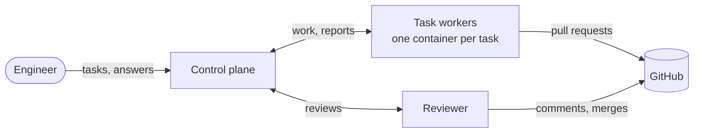
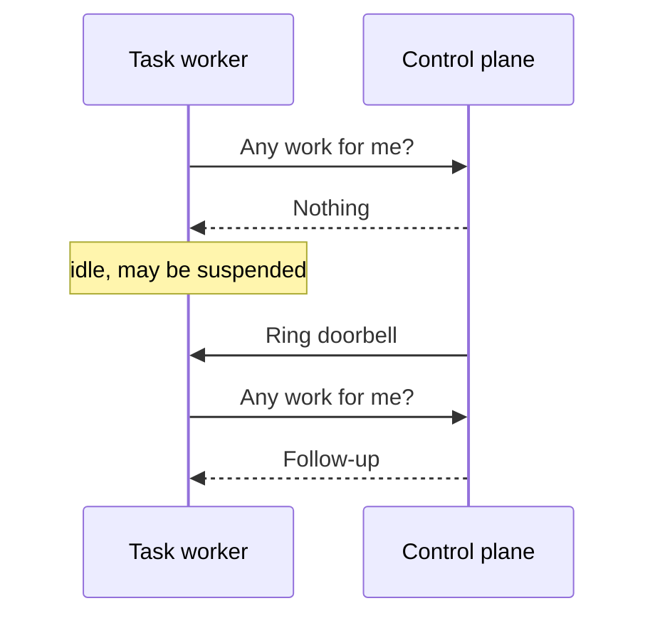
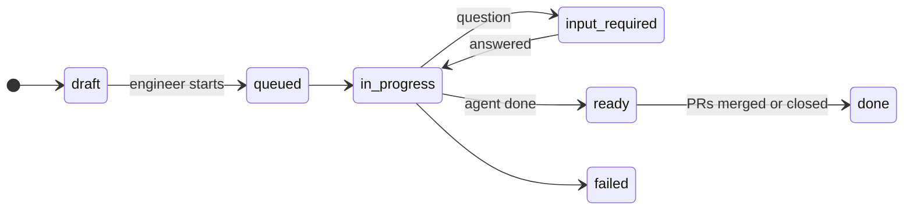

# Agentic Software Factory

Coding agents are good enough to do real work. What they lack is a workplace:
somewhere to receive a task, keep their context between conversations, stop
when they need a decision, and leave a record a human can trust without
reading a transcript.

The factory is that workplace. Engineers describe work as tasks. Each task gets
its own container and its own coding agent (`claude` or `opencode`), which
plans, implements and opens pull requests. A reviewer agent checks
specifications, answers routine questions and rates every pull request. A
local control plane holds the state and orchestrates both.



## Two kinds of agents

Not all agent work has the same shape. The factory separates it into two kinds.

| | Task workers | Reviewers |
|---|---|---|
| Lifetime | Long-living: one container and one session per task | Ad hoc: one container per review, removed afterwards |
| Context | Keeps its session, so follow-ups continue where it stopped | Starts fresh with exactly the context it needs |
| Job | Plan, implement, open pull requests | Spec review, input review, pull request review |
| Output | Plan, decisions, artifacts, questions, pull requests | One structured verdict |

A task worker is a colleague you hand a ticket to. After it reports ready, you
can still send it a follow-up ("CI fails on Node 22", "use the hash fragment,
not the query string") and it continues in the same session, with everything
it learned. Even a failed task keeps its container for a while, so it can be
revived instead of restarted.

A reviewer is a second pair of eyes: stateless, cheap, and scoped to one
question. Is this specification clear enough to start? Can I answer this
agent's question myself, or does it need the engineer? How risky is this
pull request?

## Decisions on the record, not in the transcript

An agent session is thousands of lines long. The decisions that matter are
somewhere in there, and nobody will find them.

Here, agents report through structured tools instead: `report_plan`,
`report_decision`, `report_artifact`, `ask_question`, `report_pull_request`.
The web UI shows each task as a timeline of exactly these items, next to its
pull requests, cost and a changelog of who changed what (engineer, agent,
reviewer or system). The transcript is disposable; the record is not.

Engineers work through the web UI or any MCP client.

## Idle workers can sleep

A task worker spends most of its life waiting: for an answer, for a review, for
a follow-up. Keeping it busy-waiting wastes compute; killing it loses its
session.

The factory uses a ping mechanism instead. Workers pull their work from the
control plane; the only call the control plane makes into a worker is a
doorbell that carries no content.



Because the doorbell is just an inbound request, a runtime is free to suspend an
idle worker and resume it on the next ring. The session survives on the
container's disk. And because work is pulled, a lost message is simply asked
for again.

## From supervised to fully autonomous

Autonomy is set per task, and the factory can run without a human in the
loop at all:

1. **Supervised** tasks may stop to ask a question or request approval of a
   decision. The reviewer answers what it is confident about and leaves
   product calls, scope and security to the engineer.
2. **Autonomous** tasks never stop. They still record every decision, so you
   can audit afterwards what you did not approve beforehand.
3. **Auto-merge**, per project, lets the reviewer merge pull requests it rates
   low-risk. Combined with autonomous tasks and dependencies between them, a
   queued chain of tasks runs from specification to merged code unattended.

Full autonomy rests on a model's judgment. Turn on auto-merge only where that
risk is acceptable, and read the [known gaps](docs/architecture.md#known-gaps)
first.

## Step into the session with OpenCode

Sometimes the record is not enough and you want to look over the agent's
shoulder. For tasks run with `opencode`, **Open in OpenCode** connects you to
the agent's own console inside its container: the live session, which you can
read and steer, and a terminal in the agent's workspace. It is served on
loopback only, with a password that changes with every container.

## Task lifecycle



A draft the reviewer finds unclear is held for clarification. A queued task
waits for the tasks it depends on. A `ready` or `failed` task resumes on a
follow-up: from the engineer, or from the control plane when a review is
submitted on one of its pull requests or one conflicts with its base branch
(see [hooks](docs/architecture.md#hooks)).

## Packages

- `packages/core`: domain model and rules, no I/O
- `packages/control-plane`: HTTP server, dispatcher, SQLite and Podman/GitHub adapters
- `packages/executor`: task worker image (runner and agent adapters)
- `packages/reviewer`: reviewer image (spec, input and PR reviews)
- `packages/mcp`: MCP endpoint served by the control plane at `/mcp`
- `packages/web`: React + Vite web UI

Protocol, hooks, design decisions and known gaps:
[docs/architecture.md](docs/architecture.md).

## Run locally

### Prerequisites

- Node 26 (`.nvmrc`) with Corepack for Yarn 4
- Podman (on macOS: `podman machine init && podman machine start`)
- An Anthropic API key and/or a Claude subscription token from `claude setup-token`
- A GitHub token that can clone, push and open pull requests on your target repositories

### Configuration

Put these in `.env` in the repository root (git-ignored, loaded by `yarn start`).

| Variable | Default | Meaning |
|---|---|---|
| `ANTHROPIC_API_KEY` | at least one of the two | Used by `opencode` (required for it) and by `claude` when no OAuth token is set |
| `CLAUDE_CODE_OAUTH_TOKEN` | at least one of the two | Preferred by `claude` and the reviewer; uses your subscription |
| `GITHUB_TOKEN` | required | Used by agents, reviewer and control plane |
| `FACTORY_GIT_USER_NAME`, `FACTORY_GIT_USER_EMAIL` | required | Commit author |
| `FACTORY_PORT` | `4700` | Control plane port (loopback only) |
| `FACTORY_DB` | `factory.db` | SQLite file |
| `FACTORY_IMAGE` | `factory-executor:latest` | Task worker image |
| `FACTORY_REVIEWER_IMAGE` | `factory-reviewer:latest` | Reviewer image |
| `FACTORY_REVIEWER_MODEL` | `sonnet` | `opus` or `sonnet` |
| `FACTORY_MAX_RUNNING` | `2` | Tasks worked on at once; idle workers take no slot |
| `FACTORY_FOLLOW_UP_WINDOW_HOURS` | `24` | How long a failed task keeps its container for follow-ups |
| `FACTORY_SESSION_IDLE_HOURS` | `12` | A login session ends after this many hours unused |
| `FACTORY_SESSION_MAX_DAYS` | `7` | A login session ends this many days after login, however active |

### Start

```bash
nvm use && corepack enable && yarn install
yarn image:build              # task worker and reviewer images
yarn web:build && yarn start  # http://127.0.0.1:4700
```

The engineer API, the web UI's data and `/mcp` need a signed-in user (see
[Users](#users)); create one before you start, then sign in on the web UI's
login page. Its account page (your name in the sidebar) changes your display
name and password and manages your personal access tokens. Scripts sign in
with the API:

```bash
curl -c cookies.txt -H 'content-type: application/json' \
  -d '{"username":"alice","password":"..."}' http://127.0.0.1:4700/auth/login
curl -b cookies.txt http://127.0.0.1:4700/auth/me
```

`POST /auth/login` sets an `HttpOnly` session cookie, `POST /auth/logout`
ends the session, `GET /auth/me` names the signed-in user. Repeated failed
logins for a username or from a client are locked out for a while (HTTP 429).

| Endpoint | Effect |
|---|---|
| `PATCH /auth/me` `{"displayName":"..."}` | Change your display name; returns `{id, username, displayName}` |
| `POST /auth/password` `{"currentPassword":"...","newPassword":"..."}` | Change your password (12–256 characters); a wrong current one is 400 `wrong_password`. Ends your other sessions |
| `GET /users` | `[{id, username, displayName, disabled}]` of every user, so clients can show names for the user ids in records |

The first two need a session, like token management below.

### Personal access tokens and MCP

MCP clients and scripts cannot keep a browser cookie, so they act as a user
with a personal access token instead: `Authorization: Bearer fct_...` on the
engineer API and `/mcp`. Create one with the CLI (it is printed once; only its
SHA-256 is stored):

```bash
yarn user token alice laptop                       # never expires
yarn user token alice ci --expires-in-days 90
```

or on the web UI's account page, which shows the new token once together
with the `claude mcp add` command below, or, signed in with a session, with
the API:

```bash
curl -b cookies.txt -H 'content-type: application/json' \
  -d '{"name":"laptop","expiresInDays":90}' http://127.0.0.1:4700/auth/tokens
curl -b cookies.txt http://127.0.0.1:4700/auth/tokens                # list your tokens
curl -b cookies.txt -X DELETE http://127.0.0.1:4700/auth/tokens/<id>  # revoke one
```

Then add the MCP server to Claude Code; every tool call runs as that user:

```bash
claude mcp add --transport http factory http://127.0.0.1:4700/mcp \
  --header "Authorization: Bearer fct_..."
```

A user sees and revokes only its own tokens, and managing tokens needs a
session: a request authenticated by a token gets 403 there. A revoked or
expired token, a token of a disabled user, and any invalid `Authorization`
header get 401 (the cookie is not tried then). The `expiresInDays` limit is
1–3650; names are 1–100 characters.

### Users

Everyone who uses the engineer API, the web UI or `/mcp` signs in as a user.
Users are managed with an operator CLI that writes to the same SQLite file as
the control plane (`FACTORY_DB`, default `factory.db`). Create the first user:

```bash
yarn user add alice --display-name "Alice"   # prompts for the password twice
```

| Command | Effect |
|---|---|
| `yarn user add <username> [--display-name <name>]` | Create a user and set its password |
| `yarn user list` | Username, display name, status (active/disabled) and creation time of every user |
| `yarn user passwd <username>` | Set a new password |
| `yarn user rename <username> <display name...>` | Change the display name |
| `yarn user disable <username>` | Disable the user for good, end its sessions and revoke its tokens; it keeps its id and history |
| `yarn user token <username> <name...> [--expires-in-days <n>]` | Create a personal access token and print it once (only the token, so `$(...)` captures it) |

Passwords are never taken from the command line. On a terminal they are
prompted without echo; otherwise the first line of stdin is used, without
confirmation, for scripting:

```bash
printf '%s\n' "$PW" | yarn user passwd alice
```

Passwords must be 12 to 256 characters long and are stored as scrypt hashes.

### Develop

```bash
yarn test
yarn typecheck
yarn web:dev   # UI with hot reload on http://localhost:5173; needs the control plane running
```

Node runs the TypeScript sources directly; only the web UI is built. Rebuild
the images after changing `packages/core`, `packages/executor` or
`packages/reviewer`.
